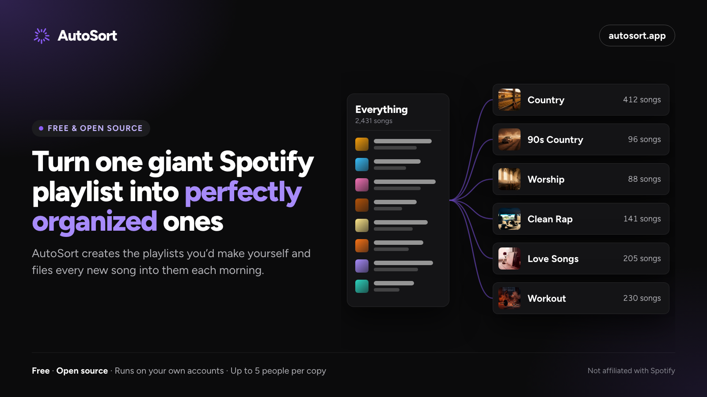
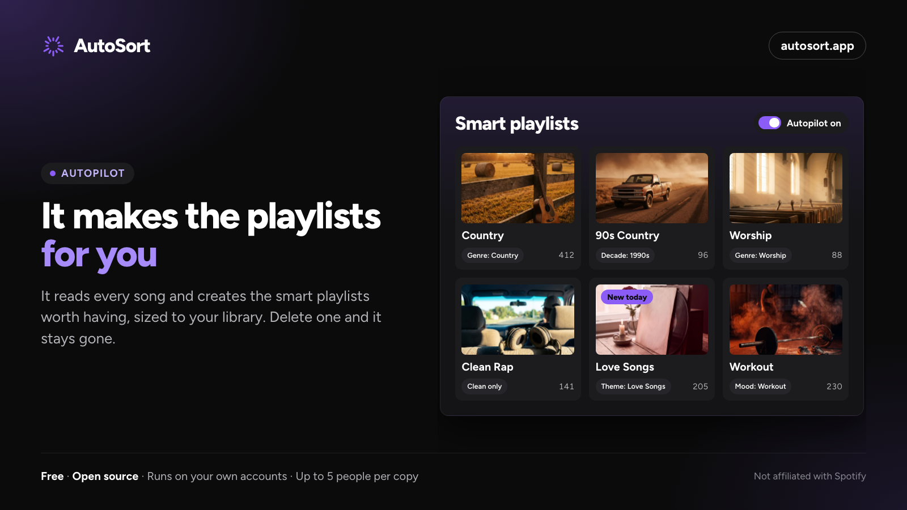
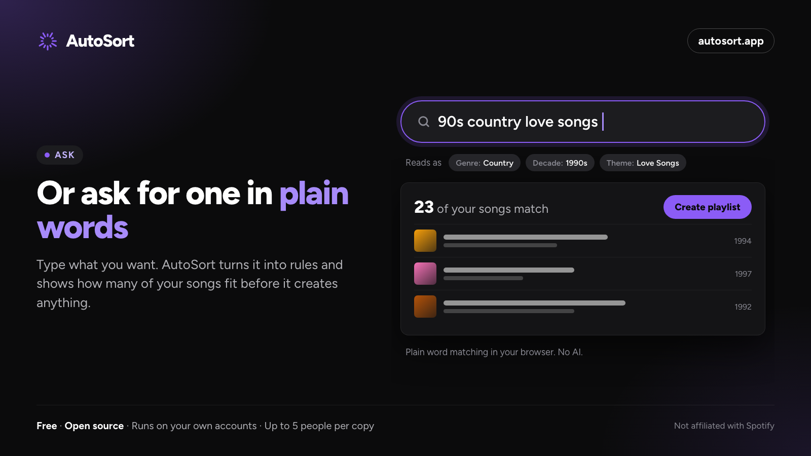
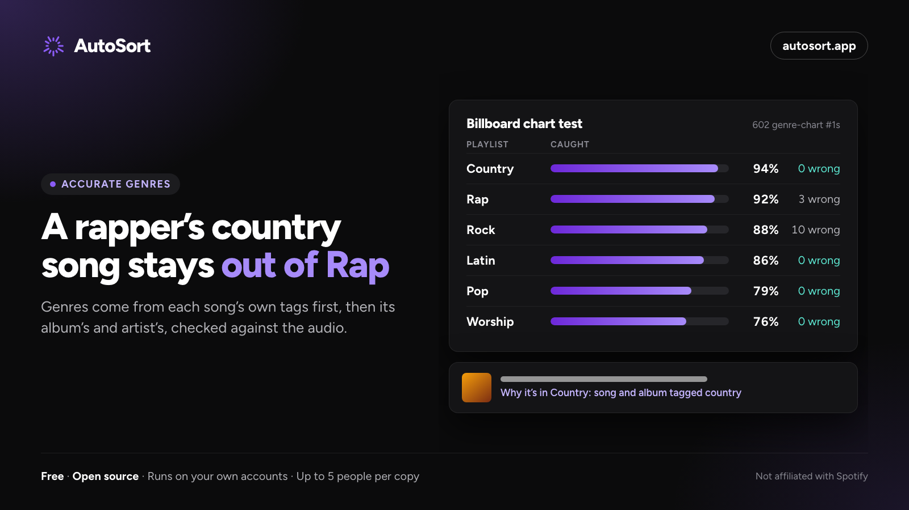

<p align="center">
  
</p>

<p align="center">
  Keep adding songs to the one Spotify playlist you always use.<br>
  AutoSort creates the playlists you'd make yourself and files every new song into them each morning.
</p>

<p align="center">
  <a href="https://vercel.com/new/clone?repository-url=https%3A%2F%2Fgithub.com%2Fiamtravjohnson%2Fautosort%2Ftree%2Fmain%2Fapps%2Fweb&amp;project-name=autosort&amp;repository-name=autosort&amp;env=SPOTIFY_CLIENT_ID%2CSPOTIFY_CLIENT_SECRET%2CLASTFM_API_KEY&amp;envDescription=Your+Spotify+developer+app%E2%80%99s+Client+ID+and+Client+Secret%2C+and+a+free+Last.fm+API+key+%28AutoSort+uses+it+to+tell+genres+apart%29&amp;envLink=https%3A%2F%2Fautosort.app%2Fdocs%2Fquick-start%23keys&amp;stores=%5B%7B%22type%22%3A%22integration%22%2C%22integrationSlug%22%3A%22neon%22%2C%22productSlug%22%3A%22neon%22%2C%22protocol%22%3A%22storage%22%7D%5D&amp;demo-title=AutoSort&amp;demo-description=Turn+one+giant+Spotify+playlist+into+smart+playlists+that+stay+organized.+Free%2C+open+source%2C+and+yours.&amp;demo-url=https%3A%2F%2Fautosort.app&amp;demo-image=https%3A%2F%2Fraw.githubusercontent.com%2Fiamtravjohnson%2Fautosort%2Fmain%2Fdocs%2Fimages%2Fbanner.png"></a><br>
  <sub>About 15 minutes on free accounts · or <a href="docs/setup-with-ai.md">have an AI walk you through it</a></sub>
</p>

<p align="center">
  <a href="#what-it-does">Features</a> ·
  <a href="#why-self-hosted">Why self-hosted</a> ·
  <a href="#before-you-deploy">Before you deploy</a> ·
  <a href="https://autosort.app/docs/quick-start">Quick start</a> ·
  <a href="https://autosort.app/changelog">Changelog</a>
</p>

## Why AutoSort

**It makes the playlists for you.** Point it at your "Everything" playlist and Autopilot creates the ones worth having (*Country*, *90s Country*, *Clean Rap*, *Worship*, *Workout*, *Love Songs* and more), sized to your library. As your library grows into something new, it adds a playlist for it.

**Genres that hold up.** A rapper's country song lands in Country, not Rap. Genres come from each song's own tags first, then its album's and artist's, checked against the audio, and they're [measured on Billboard chart number ones](packages/core/eval/RESULTS.md).

**Nothing to look after.** Every morning, new songs are filed into every playlist they fit. Songs you delete from a smart playlist stay out, and every sync can be undone.

**Free, and yours.** AutoSort is open source under the MIT license. You run your own copy on free accounts, your data stays in your own database, and up to 4 family members can use it with you.

## What it does

### Autopilot makes the playlists for you

<p align="center">
  
</p>

Autopilot is on by default. It reads every song and creates the smart playlists worth having, sized to your library. Delete one and it stays gone.

### Ask for a playlist in plain words

<p align="center">
  
</p>

Type what you want, like "90s country love songs" or "clean rap for the gym". AutoSort turns it into rules you can see and edit, and shows how many of your songs fit before it creates anything. It's plain word matching, with no AI.

### Genres you can check

<p align="center">
  
</p>

The playlist editor shows why each song got its genre. The genre rules are tested against Billboard chart number ones, and [the results are in the repo](packages/core/eval/RESULTS.md).

### And more

- A song goes in **every playlist it fits**: a 90s country love song can be in *Country*, *90s Country* and *Love Songs*.
- **Covers**: Spotify's own album mosaic by default, or optional photo covers.
- **Sort** any playlist you own by BPM, energy, or harmonically around the Camelot wheel.

## Why self-hosted?

Since 2026, Spotify limits new developer apps to 5 users. So AutoSort runs as **your own copy** with **your own free Spotify developer app**: you plus up to 4 family members. Your data stays in your own database.

## Before you deploy

You'll need:

- **Spotify Premium** for whoever sets it up (Spotify requires it for developer apps in Development Mode)
- A **Spotify developer app** (free) for its Client ID and Client Secret
- A free **[Last.fm API key](https://www.last.fm/api/account/create)**, used to tell genres apart
- Free **GitHub** and **Vercel** accounts. The Deploy button creates the database for you.

The [quick start](https://autosort.app/docs/quick-start) walks through each step, and [troubleshooting](https://autosort.app/docs/troubleshooting) covers the common errors.

> **Status:** early release. Made by [Travis Johnson](https://travisjohnson.com) ([@iamtravjohnson](https://x.com/iamtravjohnson)). Website: [autosort.app](https://autosort.app)

## What's here

| Path | What it is |
|---|---|
| [`packages/core`](packages/core) | The engine: Spotify client, data lookups, rules, smart-playlist suggestions, sorting (BPM, key, Camelot, energy arcs) and the daily sync planner. No framework or database. |
| [`apps/web`](apps/web) | The self-hosted app (Next.js + Postgres), with one-click deploy to Vercel. |
| [`apps/site`](apps/site) | The autosort.app website and docs. |

## Where the data comes from

| Data | Source |
|---|---|
| Your playlists, songs, explicit flag, release date | Spotify Web API (your account) |
| BPM, key, energy, mood (valence), danceability, speechiness (tells rapping apart) | [ReccoBeats](https://reccobeats.com) (free, no key) |
| Original release year (fixes "Greatest Hits" dates) | [MusicBrainz](https://musicbrainz.org) |
| Genres and crowd tags (country, rap, worship, love songs, sad…) for each song, album and artist | [Last.fm](https://www.last.fm/api) (free key, needed for genre playlists) |

AutoSort doesn't send Spotify data to AI models: Spotify's Developer Policy doesn't allow it. Smart playlists are built from transparent rules you can see and edit.

## Development

```bash
pnpm install
pnpm test        # unit tests
pnpm typecheck
pnpm smoke       # live check of ReccoBeats + MusicBrainz (no keys needed)
```

## License

[MIT](LICENSE). AutoSort is an independent open-source project, not affiliated with or endorsed by Spotify.
